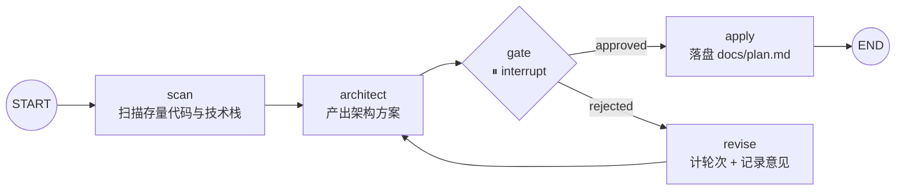

# langgraph-arch-gate

[](https://nodejs.org)
[](LICENSE)
[](tsconfig.json)

把 AI 交付流水线里最贵的一步——**架构评审**——做成一个可暂停、可恢复、可追溯的 LangGraph 工作流。

> AI 写代码很快，但「写完不敢信」。真正卡住落地的不是生成能力，而是 **谁来确认、依据是什么、出问题能不能追回来**。这个项目把这三件事工程化。

完整设计说明见 [`docs/architecture.md`](docs/architecture.md)。

## 它解决什么问题

| 问题 | 这个项目怎么解 |
|---|---|
| AI 直接落代码，架构错了返工极贵 | 评审节点前置，**架构不通过不落代码** |
| 无法回答「这行代码按什么依据改的」 | 结论落盘 `docs/plan.md`，作为唯一事实源 |
| 不可逆操作不敢交给 AI 自主执行 | `interrupt` 在闸门挂起，**人工确认后才继续** |
| 长流程断了要重头跑 | `Checkpointer` 每节点存档，同 `thread_id` 断点续跑 |
| 驳回意见丢失、反复犯同一个错 | `revise` 计轮次，意见回注下一轮方案 |

## 图结构



- 节点是纯函数：读 state，返回局部更新
- 条件边只读 `decision`，**模型无法自己批准自己**
- `revise → architect` 形成评审闭环

## 四层架构

```
cli/    入口：demo（给人看）、verify（给机器验）
  ↑
graph/  编排：nodes / edges / builder
  ↑
infra/  脏活：repo-scanner、plan-writer、checkpointer 工厂
  ↑
domain/ 状态与类型：不依赖任何层
```

依赖严格单向：上层引下层，下层不回头。换框架只动 `graph/`，换存储只动 `infra/checkpointer.ts`。

## 快速开始

```bash
npm ci
npm run demo      # 两个场景：评审通过 / 驳回后重写再通过
npm run verify    # 7 条断言验收
npm test          # 5 个单元测试
npm run typecheck # strict 类型检查
```

不需要任何模型 API Key。`architect` 节点用规则生成方案，保证 clone 下来就能跑；换成 LLM 调用即是产线形态（见 `src/graph/nodes/architect.ts`）。

## 运行示例

```
[1] 启动流水线 → 停在 gate 节点
    已暂停，等待人工确认（decision 仍为空）: true
    待审方案:
      目标：给无人机控制台加一个批量航线导入功能
      方案：
        1) 新增 arch-gate 模块承载评审逻辑，不改动既有调用方
        2) 评审结论写入 docs/plan.md，作为后续编码的唯一依据
        3) 编码前必须通过人工确认，未通过不落代码

[2] 人工确认通过 → 用同一 thread_id 恢复
    → 评审通过，已写入 docs/plan.md，可进入编码
```

## 目录

```
src/
├── domain/    # types.ts / state.ts
├── infra/     # repo-scanner.ts / plan-writer.ts / checkpointer.ts
├── graph/     # nodes/*.ts, edges.ts, builder.ts
├── cli/       # demo.ts / verify.ts
└── index.ts
tests/         # graph.test.ts（node:test）
docs/          # architecture.md（设计说明）
```

## 设计边界（已知，不藏）

- `MemorySaver` 仅进程内有效，进程退出即丢；跨进程需换 `SqliteSaver` / `PostgresSaver`
- `architect` 未接 LLM，方案为规则模板（这是为了让流程可被任何人复现）
- 无并发控制：同一 thread 并发 resume 会互相覆盖，生产需按 thread 加锁或队列串行化

## Roadmap

- [ ] 接入 `SqliteSaver`，提供跨进程续跑示例
- [ ] `architect` 接 LLM + 仓库上下文检索
- [ ] 闸门 payload 输出为前端审批卡（AG-UI 事件）
- [ ] 增加 eval 节点：评审结论 vs 最终 diff，量化返工率

## License

[MIT](LICENSE)
