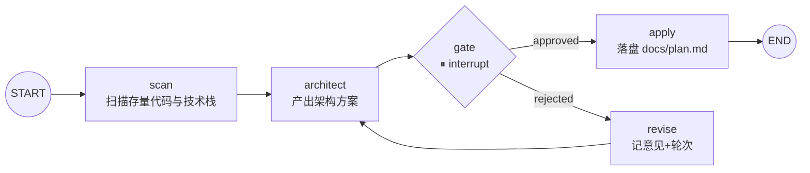

# 架构设计说明

> 这份文档就是"架构评审结论"本身：先讲怎么分层，再讲每个设计为什么这么选，最后给验收证据。

## 一、分层

四层，依赖方向严格单向，不允许反向引用。

```
        ┌──────────────────────────────┐
  第 4 层 │  cli/       入口：演示、验收     │  只依赖 index
        └──────────────┬───────────────┘
        ┌──────────────┴───────────────┐
  第 3 层 │  graph/     编排：节点、边、装配  │  只依赖 domain + infra
        └──────────────┬───────────────┘
        ┌──────────────┴───────────────┐
  第 2 层 │  infra/     脏活：扫描、落盘、存档 │  不依赖 graph，不依赖框架
        └──────────────┬───────────────┘
        ┌──────────────┴───────────────┐
  第 1 层 │  domain/    状态与类型定义      │  不依赖任何层
        └──────────────────────────────┘
```

**依赖规则**：上层可以引下层，下层绝不引上层。`domain` 连 LangGraph 都不引，只引 `Annotation` 是为了让状态定义能被框架识别——这是唯一一处例外，且只出现在 `state.ts`。

**为什么要分层**：

| 场景 | 不分层的后果 | 现在的代价 |
|---|---|---|
| 把 LangGraph 换成自研编排 / Temporal | 全项目重写 | 只换 `graph/` 与 `infra/checkpointer.ts` |
| 把内存存档换成 Postgres | 散落在节点里 | 只改 `infra/checkpointer.ts` 一处 |
| 加单测 | 节点依赖框架上下文，难测 | `domain` / `infra` 是纯函数，直接测 |

## 二、目录与职责

```
langgraph-arch-gate/
├── src/
│   ├── domain/               # 第 1 层：纯语义，无副作用
│   │   ├── types.ts          #   Approval / GatePayload / ReviewRecord
│   │   └── state.ts          #   ArchState：节点间流转的状态与 reducer
│   ├── infra/                # 第 2 层：与框架无关的脏活
│   │   ├── repo-scanner.ts   #   扫描源码文件 + 识别技术栈（评审的事实依据）
│   │   ├── plan-writer.ts    #   评审结论落盘 docs/plan.md（SSOT）
│   │   └── checkpointer.ts   #   存档介质工厂：memory → sqlite/postgres 只改这里
│   ├── graph/                # 第 3 层：编排
│   │   ├── nodes/            #   五个节点，每个一个文件、一个职责
│   │   │   ├── scan.ts       #     ① 现状扫描
│   │   │   ├── architect.ts  #     ② 产出方案（当前规则生成，可换 LLM）
│   │   │   ├── gate.ts       #     ③ 闸门：interrupt 暂停等人
│   │   │   ├── apply.ts      #     ④ 通过：落盘
│   │   │   └── revise.ts     #     ⑤ 驳回：计轮次，退回重写
│   │   ├── edges.ts          #   条件边：按"人的决定"分流
│   │   └── builder.ts        #   装配：把节点连成图 + 挂 checkpointer
│   ├── cli/
│   │   ├── demo.ts           #   两个场景的可读演示
│   │   └── verify.ts         #   七个断言的自动验收
│   └── index.ts              # 对外出口，屏蔽内部路径
├── docs/
│   ├── architecture.md       # 本文档
│   └── plan.md               # 运行后生成：某次评审的结论
├── package.json
└── README.md
```

## 三、图结构



- 节点是纯函数：读 state，返回局部更新，不碰外部副作用（副作用只在 `infra`）
- 条件边判断的是 `state.decision`，不是模型输出——这是"人说了算"在代码里的落点
- `revise → architect` 形成闭环，驳回意见会进入下一轮方案

## 四、五个关键设计决策

**1. 闸门放在编码之前，而不是编码之后**
问题：AI 直接落代码，架构错了返工极贵。
选择：`scan → architect → gate` 三段前置，不通过不进入编码。
代价：多了两次模型调用与一次人工等待；换来返修成本从"改一堆文件"降到"改一版方案"。

**2. 用 interrupt 而不是"前端弹窗自己拦"**
问题：如果确认逻辑写在前端，图形执行到一半就停了、状态留在内存里，刷新即丢。
选择：`interrupt` 把状态挂起并存档，`Command({ resume })` 从存档恢复。
代价：交互变成"提交—恢复"两段式；换来可跨进程、可审计、可回放。

**3. 结论必须落盘（SSOT）**
问题：口头对齐的评审，事后无法回答"这行代码按什么依据改的"。
选择：`apply` 节点写 `docs/plan.md`，含需求、结论、意见、轮次、时间。
代价：多一个文件要维护；换来任何一次改动都能追溯到依据。

**4. checkpointer 抽成工厂，不写死在图里**
问题：演示用内存，上线要持久化，混在一起会牵着业务走。
选择：`createCheckpointer(kind)` 一处切换。
代价：多一层间接；换来换存档介质不动业务代码。

**5. architect 先用规则生成，不接 LLM**
问题：接 LLM 需要 Key、额度、网络，任何人 clone 下来跑不动。
选择：规则生成保证 `npm run demo` 零依赖可跑；README 明确标注"换成 LLM 即产线形态"。
代价：方案内容不智能；换来可复现、可被任何人验证——这比"看起来很智能"更重要。

## 五、亮点（面试可直接讲）

1. **把"确认"做成了状态，而不是流程里的一个 if**：`interrupt` + checkpointer 让暂停可持久化、可恢复、可审计。
2. **分流依据是人不是模型**：条件边只读 `decision`，模型无法自己"批准"自己。
3. **驳回不丢意见**：`revise` 计轮次，意见回注 `architect`，形成真正的评审闭环而非单向检查。
4. **分层换取可替换性**：换框架、换存储、换模型都只动一层，不动业务。
5. **用断言验收而不是看日志**：`verify.ts` 七条断言覆盖"拦得住、放过行、驳回能回、状态不丢"。

## 六、验收证据

```
✓ 闸门确实停在人工确认前（未自动往下跑）  → decision=null
✓ 中断时已产出方案
✓ 中断时未写盘
✓ 确认通过后流程走完并落盘
✓ 驳回后退回重写并计轮次  → revision=1
✓ 二轮方案吸收了上一轮意见
✓ 跨调用保持同一状态（未重新扫描）

全部通过
```

## 七、已知边界

- `MemorySaver` 仅进程内有效，进程退出即丢；跨进程需换 `SqliteSaver`
- `architect` 未接 LLM，方案为规则模板
- 无并发控制：同一 thread 并发 resume 会互相覆盖，生产需加锁
